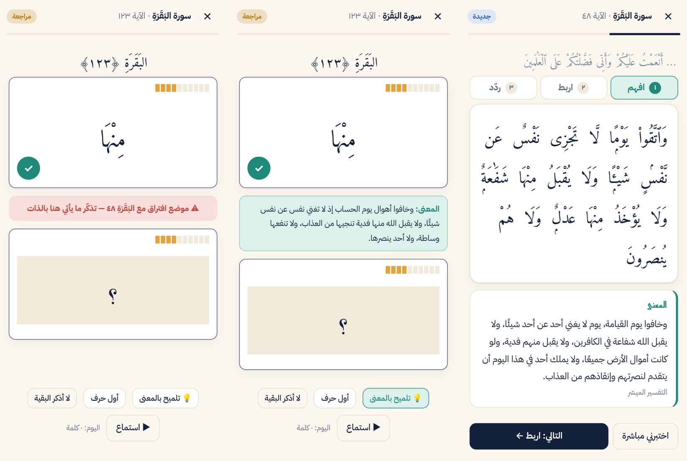
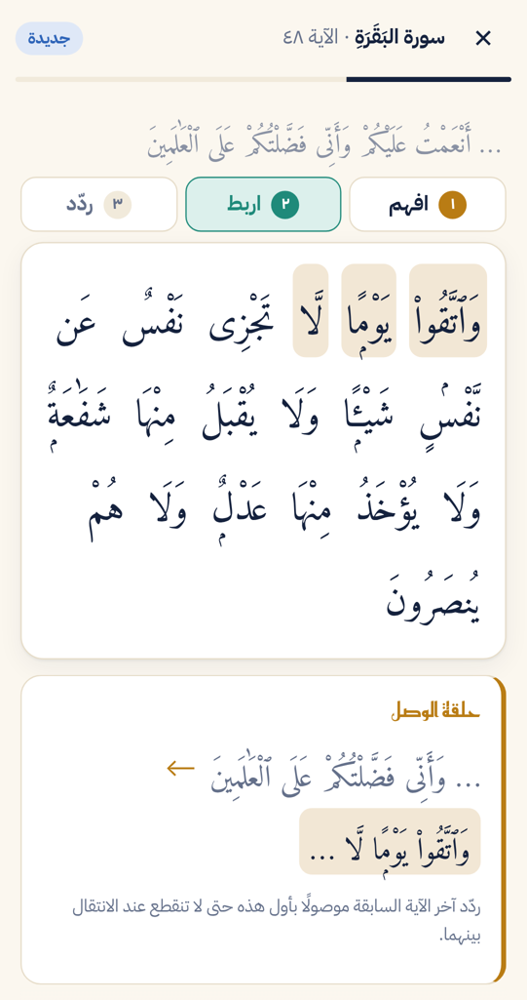

<p align="center"></p>

<p align="center">
  <a href="https://hafiz.smszs.tech/"><b>Live site</b></a> ·
  <a href="https://hafiz.smszs.tech/app/"><b>Web app</b></a> ·
  <a href="https://github.com/smssdev/Mateen/releases/latest/download/hafiz-fahim.apk"><b>Android APK</b></a> ·
  <a href="https://hafiz.smszs.tech/identity/"><b>Brand guide</b></a>
</p>

## Hafiz Fahim (English)

A Quran memorization app built on **understanding**. Every new verse is learned in three steps —
*understand* its meaning (al-Muyassar tafsir), *link* it to the end of the previous verse and to
look-alike verses, *repeat* with a reciter — and then recited **word by word** on swipeable cards.
A spaced-repetition engine keeps a strength score for every single word and schedules each verse
from it, so the exact words you stumble on come back first.

| Landing page | Recitation & hints | The "link" step |
| --- | --- | --- |
|  |  |  |

**Highlights**
- **Mutashabihat detection at build time:** verses sharing a run of 4+ normalised words are indexed
  (2,750+ verses); the app warns right before the word where two similar verses part ways.
- **Hints that teach:** ask for the verse's meaning or the word's first letter instead of revealing
  it; a hinted word counts as a slip so it is reviewed again.
- **Goals by surah, juz or the companions' seven-part division**, a mastery donut, a progress report
  to share with a teacher, offline support, dark mode and backup/restore.
- **One codebase, three targets:** a static landing page, a React PWA under `/app/`, and an Android
  app (Capacitor) — the web build works at a domain root or under any sub-path.

**Stack:** React 18 · TypeScript · Vite (multi-page) · Capacitor 6 · Vitest · ESLint · GitHub Actions
(type checks, lint and tests on every push; deploy to hafiz.smszs.tech on a self-hosted server; signed Android release with a fixed
download link).

---

# حافظ فاهم — احفظ القرآن وافهم ما تحفظ

منصة لحفظ القرآن الكريم وتحفيظه بأسلوب **الربط اللفظي والمعنوي**: تفهم الآية أولًا، وتربطها بما قبلها وبما يشبهها، ثم تسمّعها كلمةً كلمة، ويعيد عليك التطبيق مواضع ضعفك حتى تثبت.

- 🌐 **الموقع والتطبيق على الويب:** https://hafiz.smszs.tech/ (التطبيق في `/app/`، ودليل الهوية في `/identity/`)
- 📥 **تطبيق أندرويد (APK):** [تحميل مباشر لآخر نسخة](https://github.com/smssdev/Mateen/releases/latest/download/hafiz-fahim.apk)

## المنهج

**الربط المعنوي**
- **افهم قبل أن تحفظ:** كل آية جديدة تبدأ بمعناها من التفسير الميسّر.
- **تلميح بالمعنى:** إن توقفت أثناء التسميع يعرض لك المعنى بدل أن يكشف الكلمة.
- **بلا قرائن بصرية:** لا صفحات ولا أسطر؛ يعتمد الحفظ على المعنى وترابط الآيات.

**الربط اللفظي**
- **حلقة الوصل:** آخر الآية السابقة موصولًا بأول الآية الجديدة.
- **المتشابهات:** اكتشاف آلي لأكثر من ٢٧٠٠ آية لها نظائر، مع تحديد الكلمة التي تفترق عندها الآيتان، وتنبيه قبلها أثناء التسميع.
- **دقّة الكلمة:** التسميع بالبطاقات كلمةً كلمة، مع قوة حفظ لكل كلمة.

**التثبيت**
- رحلة كل آية جديدة: **افهم ← اربط ← ردّد ← سمّع**.
- مراجعة متباعدة (SRS) لكل آية مبنية على قوة كل كلمة؛ الآية التي أخطأت فيها تعود في الجلسة نفسها.
- الحفظ بالسور أو الأجزاء أو تحزيب الصحابة «فمي بشوق»، ورسم دائري لنسبة ما تحفظه من القرآن بمستوياته.
- تقرير تقدّم يشاركه الطالب مع معلّمه، وتلاوات كبار القرّاء، ونسخة احتياطية، ووضع داكن، ويعمل دون إنترنت.

## التطوير

```bash
npm install
npm run dev      # الموقع: /  — التطبيق: /app/  — الهوية: /identity/
npm test         # الاختبارات (المراجعة، الأهداف، المتشابهات، الترحيل)
npm run check    # فحص الأنواع + ESLint + الاختبارات
npm run build    # BASE=/Mateen/ npm run build للنشر تحت مسار فرعي
```

| المسار | الوصف |
| --- | --- |
| `index.html`, `src/landing/` | صفحة الهبوط (HTML + TypeScript خفيف) ودليل الهوية `identity/` |
| `app/index.html`, `src/` | تطبيق الحفظ (React + TypeScript) |
| `src/lib/srs.ts` | محرك المراجعة المتباعدة |
| `src/lib/linking.ts` | الربط: التفسير، المتشابهات، مواضع الافتراق |
| `src/components/LearnFlow.tsx` | خطوات الآية الجديدة: افهم، اربط، ردّد |
| `src/components/CardRecall.tsx` | التسميع بالبطاقات مع التلميحات وتنبيه المتشابهات |
| `public/quran/` | نص المصحف لكل سورة مع فهرس المتشابهات |
| `public/tafsir/` | التفسير الميسّر لكل سورة |
| `public/brand/` | ملفات الهوية: الرمز، الأيقونات، الشعار الكامل |
| `scripts/build-quran.mjs` | يولّد ملفات النص والتفسير والمتشابهات |

## النشر

- **الموقع:** يُستضاف على السيرفر الخاص (CloudPanel، مثل Orbit) على `https://hafiz.smszs.tech`. النشر بأمر واحد: `deploy/deploy.sh hafiz@2.24.47.100` — يبني الموقع ويرفعه إلى `releases/` ثم يبدّل الرابط `current` دفعة واحدة. خطوات الإعداد لأول مرة (سجل DNS، الموقع في CloudPanel، الشهادة) في [`deploy/README.md`](deploy/README.md). اختياريًا يرفعه `.github/workflows/deploy.yml` تلقائيًا إلى السيرفر نفسه بعد إضافة أسرار SSH.
- **بطاقة المشروع لموقع smszs.tech:** جاهزة في `docs/portfolio/`.
- **أندرويد:** `.github/workflows/android.yml` يبني التطبيق (Capacitor) وينشره كـ Release. التوقيع من أسرار GitHub: `MATEEN_KEYSTORE_BASE64` و`MATEEN_KEYSTORE_PASSWORD` و`MATEEN_KEY_ALIAS` و`MATEEN_KEY_PASSWORD`، ومحليًا من `android/keystore.properties` (غير مرفوع). لا ترفع ملف المفتاح أبدًا.

```bash
npm run android:sync
cd android && ./gradlew assembleRelease bundleRelease
```

## المصادر

- نص المصحف: الرسم العثماني من [مشروع تنزيل](https://tanzil.net) — منقول دون أي تعديل.
- التفسير: التفسير الميسّر — مجمع الملك فهد لطباعة المصحف الشريف (عبر api.alquran.cloud).
- التلاوات: [everyayah.com](https://everyayah.com).
