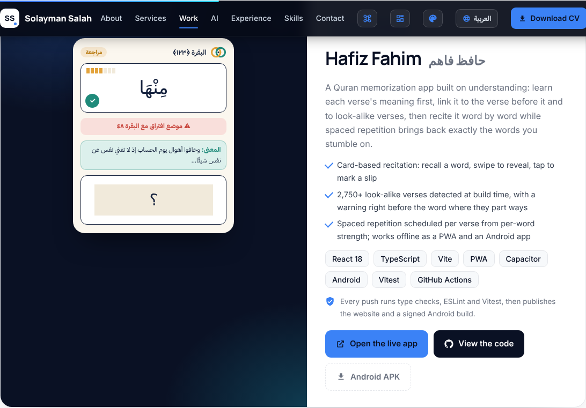
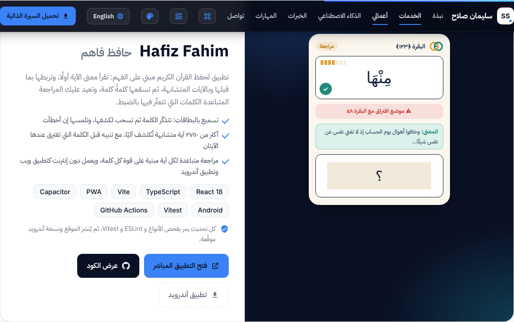

# Hafiz Fahim card for smszs.tech

A drop-in project card for the "Selected work" section of https://smszs.tech/, written in the
site's own markup (`article.proj`, `.proj-vis`, `.proj-body`, `data-i18n` keys) and previewed on a
copy of the live page in English and Arabic:

| English | العربية |
| --- | --- |
|  |  |

## How to add it

1. **Card** — paste `card.html` right after the Orbit `<article class="proj reveal">…</article>`
   (before `
`).
2. **Styles** — paste `card.css` inside the page's main `<style>` block.
3. **Arabic text** — paste the lines of `i18n-ar.js` into the Arabic dictionary, next to the
   `o_…` (Orbit) keys. English text lives in the HTML itself, as with the other cards.
4. **Command palette** — paste the two lines of `palette.js` into the actions list, next to the
   Orbit entries.

## Links to update

The card points to `https://hafiz.smszs.tech/`, served from the same server as smszs.tech (see
[`deploy/README.md`](../../deploy/README.md)). The APK link is
`https://github.com/smssdev/Mateen/releases/latest/download/hafiz-fahim.apk`.
